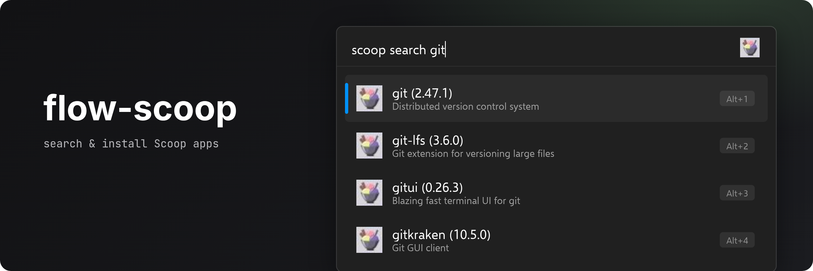

<!-- generated by readwright from docs/README.md.j2; edit the template, not this file -->


# Flow Scoop

Search Scoop buckets and install, update or remove apps from Flow Launcher.

[](https://github.com/Garulf/Flow-Scoop/actions/workflows/tests.yml) [](https://github.com/Garulf/Flow-Scoop/releases/latest)

[](https://www.buymeacoffee.com/garulf) [](https://github.com/sponsors/Garulf)

## Features

* **Search your buckets.** Finds apps by name in every bucket you have added, straight from disk.
* **Install in one step.** Pick a result and Scoop installs it in a new terminal.
* **Manage installed apps.** Update or uninstall from the context menu, or open the app's folder.
* **Homepage links.** Jump to an app's homepage from its manifest.

## Usage

Type `scoop` to see the commands, then pick one or type it out:

| Query | Result |
| --- | --- |
| `scoop search <name>` | Apps in your local buckets whose name contains `<name>` (up to 25). `Enter` installs |
| `scoop list` | Your installed apps, from `scoop export` |

```
scoop search git
```


```
scoop list
```


### Context menu

Open the context menu (`Shift+Enter` or right-click) on an installed app to uninstall or update it,
reveal its folder in Explorer or open its homepage. On an app that is not installed it offers
**Install** instead:


Install, update and uninstall open a terminal running `scoop install`, `scoop update` or
`scoop uninstall`, so you can follow Scoop's output.

## Installation

Flow Scoop is not in the Flow Launcher plugin store yet. Download `Flow-Scoop-<version>.zip` from the
[latest release](https://github.com/Garulf/Flow-Scoop/releases/latest) and unzip it into
`%appdata%\FlowLauncher\Plugins`, then restart Flow Launcher.

Pre-releases of the next version are published from the open release PR on the
[releases page](https://github.com/Garulf/Flow-Scoop/releases) for testing.

## Requirements

* [Scoop](https://scoop.sh) installed in the default location (`%USERPROFILE%\scoop`)
* Flow Launcher 1.17.0 or newer
* Python 3.8 or newer, which Flow Launcher can install for you
